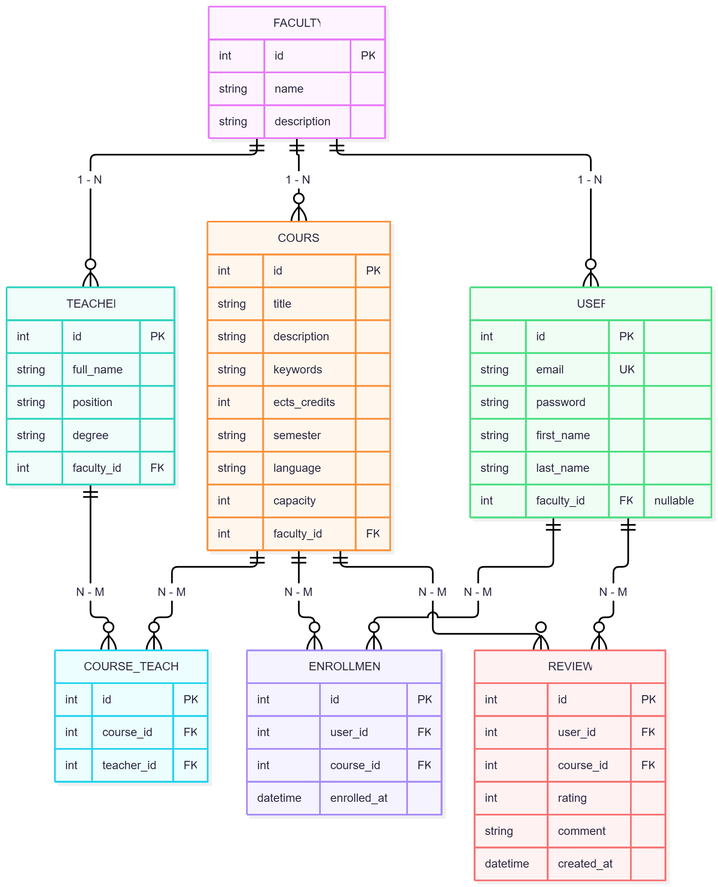

# CourseHub

## Ідея

Платформа для зручного вибору та запису на вибіркові університетські дисципліни. 
Студент часто обирає дисципліни вільного вибору навмання: інформація розкидана
по різних сторінках, незрозуміло, скільки залишилось місць, і ніхто не знає,
що думають про курс ті, хто його вже проходив.

**CourseHub** збирає це в одному місці:

- каталог курсів з пошуком за назвою й ключовими словами;
- фільтри за факультетом, викладачем, семестром і мовою викладання;
- сортування за кількістю кредитів ECTS, рейтингом серед студентів і кількістю вільних місць;
- сторінки викладачів і факультетів, де видно їхні курси;
- відгуки та оцінки студентів, з яких складається рейтинг курсу;
- запис на курс і скасування запису;
- профіль студента з історією його записів.

---

---

## Статус реалізації

| Розділ | Статус |
|---|---|
| Факультети, викладачі, курси: перегляд, створення, зміна, видалення | ✅ реалізовано |
| Реєстрація, логін (JWT), оновлення токена, дані поточного користувача | ✅ реалізовано |
| Вихід з акаунта | ✅ на клієнті: токени видаляються (див. нижче) |
| Права доступу за ролями (гість, користувач, адміністратор) | ✅ реалізовано |
| Відгуки, записи на курси, «Про нас», пошук і фільтри списку курсів | ⏳ заплановано |

Поточна реалізація простіша за початковий дизайн і схему БД внизу: у курсу один викладач (`teacher`), у курсу є `credits` (кредити, крок 0.5), списки повертаються звичайним масивом без пагінації.

## Як запустити проєкт

Потрібен Python 3.12 або новіший. Команди виконуються з теки, де лежить `manage.py`.

```bash
python -m venv .venv
source .venv/bin/activate        # Windows: .venv\Scripts\activate
python -m pip install -r requirements.txt
python manage.py migrate         # створює таблиці
python manage.py createsuperuser # акаунт адміністратора (роль admin)
python manage.py runserver
```

- Бекенд: `http://localhost:8000`, API: `http://localhost:8000/api/`.
- CORS дозволено для фронтенду на `http://localhost:3000` і `http://127.0.0.1:3000`. Фронтенд лежить в окремому репозиторії.
- Звичайних користувачів створює реєстрація (`POST /api/auth/register/`). Адміністратор створюється лише командою `createsuperuser`.
- Postman-колекція: `postman/CourseHub.postman_collection.json` (див. розділ «Postman»).
- Перевірка стилю коду: `python check_submission.py`.

---

## Формат помилок

Усі помилки API мають однакову форму: ключ `error` з текстом. Для помилок валідації (`400`) додається `details` з повідомленнями по кожному полю.

```json
{ "error": "Курс з таким ID не знайдено." }
```

```json
{
  "error": "Передані невалідні дані.",
  "details": { "email": ["Введіть коректну адресу електронної пошти."] }
}
```

| Статус | Коли |
|---|---|
| `400` | невалідні дані, некоректний JSON |
| `401` | немає access токена, він недійсний або прострочений; неправильний логін чи пароль |
| `403` | користувач увійшов, але не має прав (наприклад, видалення без ролі адміністратора) |
| `404` | об'єкта з таким `id` немає |
| `405` | метод не підтримується |
| `409` | дані валідні, але операція суперечить поточному стану (видалення факультета чи викладача, на якого є посилання) |

---

## Автентифікація (JWT)

### Як це працює

1. Користувач реєструється (`/api/auth/register/`) і входить (`/api/auth/login/`). У відповідь він отримує **два токени**:
   - **access** живе **5 хвилин**. Його треба передавати з кожним запитом, який потребує авторизації.
   - **refresh** живе **1 добу**. Він потрібен лише для того, щоб отримати новий access токен.
2. Токен передається в заголовку:

   ```
   Authorization: Bearer <access токен>
   ```

3. Коли access токен закінчується, сервер відповідає `401`. Тоді клієнт надсилає refresh токен на `POST /api/auth/refresh/`, отримує новий access токен і повторює запит. Користувачу не треба логінитись знову. Якщо refresh токен теж прострочений або недійсний, refresh повертає `401`, і тоді потрібен новий логін. Фронтенд робить це автоматично.
4. **Logout** виконується на клієнті: збережені access і refresh токени видаляються. Окремого запиту на сервер немає, бо сервер токенів не зберігає (JWT перевіряється за підписом). Вже виданий access токен лишається чинним до закінчення свого терміну (5 хв).
5. Чому два токени: короткоживучий access менше шкодить, якщо його вкрадуть, а довгоживучий refresh передається рідко й лише на один адрес.

Токени підписуються секретним ключем Django (`SECRET_KEY`). У справжньому проєкті цей ключ не можна тримати в репозиторії. Паролі зберігаються лише у вигляді хешу (PBKDF2).

Налаштування термінів життя: `SIMPLE_JWT` у `config/settings.py`.

### `POST /api/auth/register/`: реєстрація

Доступ: усі. Тіло запиту:

```json
{
  "username": "student1",
  "first_name": "Олена",
  "last_name": "Коваль",
  "email": "student1@example.com",
  "password": "Sup3rSecret!x",
  "password_confirm": "Sup3rSecret!x"
}
```

| Поле | Обов'язкове | Обмеження |
|---|---|---|
| `username` | так | 3–30 символів, лише літери, цифри та `@ . + - _`; унікальний (без урахування регістру) |
| `first_name` | ні | до 50 символів |
| `last_name` | ні | до 50 символів |
| `email` | так | коректний формат, до 254 символів, унікальний |
| `password` | так | від 8 до 128 символів; не надто поширений, не лише цифри, не схожий на username чи email |
| `password_confirm` | так | має збігатися з `password` |

Відповідь `201` (пароль не повертається):

```json
{ "id": 7, "username": "student1", "first_name": "Олена", "last_name": "Коваль", "email": "student1@example.com", "role": "user" }
```

Помилка `400`: повідомлення для кожного невірного поля.

```json
{
  "error": "Передані невалідні дані.",
  "details": {
    "email": ["Введіть коректну адресу електронної пошти."],
    "password_confirm": ["Паролі не збігаються."]
  }
}
```

### `POST /api/auth/login/`: вхід

Доступ: усі. Тіло запиту: `{ "username": "student1", "password": "Sup3rSecret!x" }`

Відповідь `200`:

```json
{
  "access": "eyJhbGciOi...",
  "refresh": "eyJhbGciOi...",
  "user": { "id": 7, "username": "student1", "first_name": "Олена", "last_name": "Коваль", "email": "student1@example.com", "role": "user" }
}
```

Помилки: `400` (не передано `username` чи `password`), `401` `{ "error": "Невірний username або пароль." }`.

### `POST /api/auth/refresh/`: новий access токен

Доступ: усі (потрібен refresh токен). Тіло запиту: `{ "refresh": "eyJhbGciOi..." }`

Відповідь `200`: `{ "access": "eyJhbGciOi..." }`

Помилки: `400` (немає `refresh`), `401` `{ "error": "Refresh токен недійсний або термін його дії закінчився. Увійдіть знову." }`

### `GET /api/auth/me/`: поточний користувач

Доступ: лише авторизовані. Заголовок: `Authorization: Bearer <access>`.

Відповідь `200`: користувач у тому ж форматі, що й `user` у відповіді логіну (`role` це `admin` або `user`).
Помилка `401`, якщо токена немає чи він недійсний.

---

## Права доступу

Ролі: **гість** (без токена), **користувач** (зареєстрований) і **адміністратор** (створюється командою `createsuperuser`).

| Дія | Гість | Користувач | Адміністратор |
|---|---|---|---|
| `GET` списків і окремих об'єктів (факультети, викладачі, курси) | ✅ | ✅ | ✅ |
| `POST` (створення) | `401` | ✅ | ✅ |
| `PUT` (зміна) | `401` | ✅ | ✅ |
| `DELETE` (видалення) | `401` | `403` | ✅ |
| `GET /api/auth/me/` | `401` | ✅ | ✅ |
| `register`, `login`, `refresh` | ✅ | ✅ | ✅ |

Приклади відповідей без доступу:

`401`, токена немає:

```json
{ "error": "Потрібна авторизація. Передайте access токен у заголовку Authorization: Bearer <токен>." }
```

`401`, токен недійсний або прострочений:

```json
{ "error": "Access токен недійсний або термін його дії закінчився. Оновіть його через /api/auth/refresh/ або увійдіть знову." }
```

`403`, користувач без ролі адміністратора намагається видалити:

```json
{ "error": "Недостатньо прав: ця дія доступна лише адміністраторам." }
```

> Якщо разом із запитом надіслати **недійсний** токен, навіть публічний `GET` поверне `401`. Тому клієнт має або не надсилати токен у публічних запитах, або оновити його.

---

## Ендпоінти каталогу

У всіх запитах, позначених 🔒, потрібен заголовок `Authorization: Bearer <access>`. 🛡️ означає, що потрібна роль адміністратора. `PUT` замінює об'єкт повністю (усі обов'язкові поля обов'язкові).

### Факультети

| Метод | URL | Призначення | Доступ | Успіх |
|---|---|---|---|---|
| GET | `/api/faculties/` | Список | всі | `200` |
| POST | `/api/faculties/` | Додати | 🔒 | `201` |
| GET | `/api/faculties/{id}/` | Один факультет | всі | `200` |
| PUT | `/api/faculties/{id}/` | Змінити | 🔒 | `200` |
| DELETE | `/api/faculties/{id}/` | Видалити | 🛡️ | `204` |

Тіло запиту (`POST`, `PUT`): `{ "name": "ФСНСТ", "description": "Факультет соціальних наук" }`. `name` обов'язкове й унікальне.
Відповідь: `{ "id": 1, "name": "ФСНСТ", "description": "..." }`.
Помилки: `400`, `401`, `403`, `404`; для `DELETE` ще `409`, якщо за факультетом закріплені викладачі чи курси:

```json
{ "error": "Неможливо видалити факультет, оскільки до нього прив'язано 2 об'єкт(ів) (викладачів або курсів)." }
```

### Викладачі

| Метод | URL | Призначення | Доступ | Успіх |
|---|---|---|---|---|
| GET | `/api/teachers/` | Список | всі | `200` |
| POST | `/api/teachers/` | Додати | 🔒 | `201` |
| GET | `/api/teachers/{id}/` | Один викладач | всі | `200` |
| PUT | `/api/teachers/{id}/` | Змінити | 🔒 | `200` |
| DELETE | `/api/teachers/{id}/` | Видалити | 🛡️ | `204` |

Тіло запиту: `first_name`, `last_name`, `position`, `faculty` (id) обов'язкові, `email` необов'язковий. Посада: `professor`, `associate_professor`, `senior_lecturer` або `assistant`.

```json
{ "first_name": "Максим", "last_name": "Яковлєв", "position": "associate_professor", "email": "yakovlev@ukma.edu.ua", "faculty": 1 }
```

Відповідь містить `id` і ті самі поля. Помилки: `400`, `401`, `403`, `404`; `DELETE` повертає `409`, якщо за викладачем закріплені курси.

### Курси

| Метод | URL | Призначення | Доступ | Успіх |
|---|---|---|---|---|
| GET | `/api/courses/` | Список | всі | `200` |
| POST | `/api/courses/` | Додати | 🔒 | `201` |
| GET | `/api/courses/{id}/` | Один курс | всі | `200` |
| PUT | `/api/courses/{id}/` | Змінити | 🔒 | `200` |
| DELETE | `/api/courses/{id}/` | Видалити | 🛡️ | `204` |

Тіло запиту: `title`, `credits`, `faculty` (id), `teacher` (id) обов'язкові, `description` необов'язкове. Кредити від 1 до 15 з кроком 0.5.

```json
{ "title": "Вступ до політичної аналітики", "description": "Базові методи аналізу.", "credits": 4.5, "faculty": 1, "teacher": 1 }
```

Відповідь (`credits` повертається рядком, бо це десяткове число):

```json
{ "id": 3, "title": "Вступ до політичної аналітики", "description": "Базові методи аналізу.", "credits": "4.5", "faculty": 1, "teacher": 1 }
```

Помилки: `400` (кредити поза діапазоном чи не кратні 0.5, факультету чи викладача не існує), `401`, `403`, `404`.

---

## Postman

Колекція `postman/CourseHub.postman_collection.json` (формат v2.1). Змінна `base_url` дорівнює `http://127.0.0.1:8000` (шляхи в запитах починаються з `/api/`). Папка **Auth** містить запити реєстрації (успішна й з помилками), логіну, оновлення токена та `/me/`. Запит логіну сам зберігає токени у змінні `access_token` і `refresh_token`, а запити, що потребують авторизації, використовують їх через `Bearer`. Запити зі змінами (`POST`, `PUT`) надсилають токен звичайного користувача, а видалення (`DELETE`) використовує токен адміністратора: створіть його командою `createsuperuser` і задайте змінні `admin_username` та `admin_password` у колекції, потім запустіть запит «Login as administrator». Папки запускайте по порядку.

---

## Заплановані ендпоінти

Нижче лишається проєктна документація для наступних робіт.

### Відгуки на курси

| Метод | URL | Призначення |
|---|---|---|
| GET | `/api/courses/{id}/reviews/` | Відгуки на курс |
| POST | `/api/courses/{id}/reviews/` 🔒 | Залишити відгук |
| PATCH | `/api/reviews/{id}/` 🔒 | Змінити свій відгук |
| DELETE | `/api/reviews/{id}/` 🔒 | Видалити свій відгук |

#### `GET /api/courses/{id}/reviews/`

Response `200`:

```json
[
  { "id": 9, "author": "Олена К.", "rating": 5, "comment": "Дуже корисний курс", "created_at": "2026-09-20 10:00:00" }
]
```

#### `POST /api/courses/{id}/reviews/` 🔒

Request body: `{ "rating": 5, "comment": "Дуже корисний курс" }` (`rating` від 1 до 5).
Response `201`: створений відгук.
Помилки: `400` (оцінка поза діапазоном).

#### `PATCH /api/reviews/{id}/` 🔒

Request body: `{ "rating": 4, "comment": "..." }`. 
Response `200`. 
Помилки: `403` (не мій відгук), `404`.

#### `DELETE /api/reviews/{id}/` 🔒

Response `204`. 
Помилки: `403`, `404`.

---

### Записи на курси

| Метод | URL | Призначення |
|---|---|---|
| POST | `/api/enrollments/` 🔒 | Записатися на курс |
| DELETE | `/api/enrollments/{id}/` 🔒 | Скасувати свій запис |

#### `POST /api/enrollments/` 🔒

Request body: `{ "course_id": 3 }`

Response `201`:

```json
{ "id": 15, "course_id": 3, "enrolled_at": "2026-10-10 14:30:00" }
```

Помилки:
- `404`, якщо курсу не існує;
- `409`, якщо вільних місць немає або користувач уже записаний на цей курс.

#### `DELETE /api/enrollments/{id}/` 🔒

Response `204`. Помилки: `403`, `404`.

---

### Про нас

| Метод | URL | Призначення |
|---|---|---|
| GET | `/api/about/` | Контакти та правила запису |

Response `200`:

```json
{
  "contacts": "Деканат ФСНСТ, корпус 6, кабінет 213, тел. (044) 463 58 63",
  "enrollment_rules": "Запис на курси відкритий до початку семестру. Скасувати запис можна до його старту."
}
```

---

## Схема бази даних

